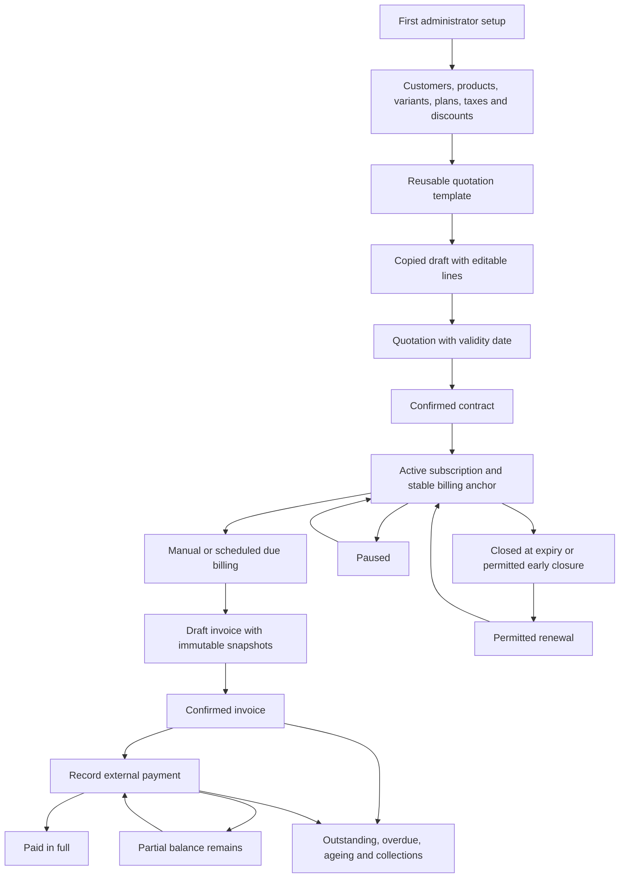
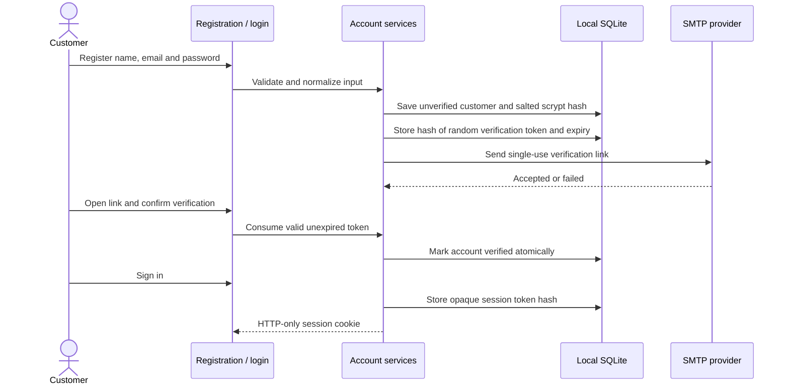

# Brightloop: complete project flow

This is the walkthrough for a reviewer, teammate or demonstrator. It describes the implemented application, with external prerequisites identified explicitly. Read the [requirements checklist](REQUIREMENTS_TRACEABILITY.md), [verification guide](VERIFICATION.md) and [reviewer questions](REVIEWER_QUESTIONS.md) alongside it.

## 1. What the project solves

Brightloop replaces separate spreadsheets for plans, quotations, renewals, invoices and payments with one locally persisted subscription workspace. Administrators configure the business, staff handle day-to-day operations and customers see their own records. Payments record money received elsewhere: the application does not charge cards.

## 2. Start the workspace

1. Install Node 24 and run `npm ci` in the repository.
2. Copy `.env.example` to `.env.local`; retain local database paths. Keep this file untracked.
3. Run `npm run dev` and open `http://127.0.0.1:3000/auth/setup`.
4. Create the first administrator. A later setup request redirects to login.
5. Configure SMTP before expecting email in a real inbox. Without it, the app records a clear failure and does not claim delivery.

For an isolated demonstration, run `npm run seed` with `DEMO_SQLITE_PATH` set to a new `demo-*.sqlite` file. It prints development-only credentials. Set `SQLITE_PATH` to that demo database and restart. Never seed the operational database.

## 3. Account and email verification

- Passwords need 9–128 characters, uppercase, lowercase and a special character.
- Email is normalized and unique. Public signup cannot choose an administrator/staff role.
- Unverified customers cannot log in. Resending supersedes the old link; requests are rate-limited.
- Links expire after 30 minutes and cannot be reused.
- Password recovery uses a neutral response. A successful reset revokes every existing session.
- Only administrators invite staff. The recipient sets a password through an expiring link; the administrator never knows their permanent password.
- Changing email requires the current password and verification of the new address. Record ownership remains attached to the same immutable user ID.
- Password changes and revoke-all sign the user out. Sessions also expire after 24 hours or 30 idle minutes.

`npm run test:auth` proves these flows through browser forms and received messages on a loopback-only SMTP server. It sends no external email. Gmail inbox testing separately requires a configured Google app password and an authorized recipient.

## 4. Configure the business

| Configuration | Administrator enters                                                                | Used by                                     |
| ------------- | ----------------------------------------------------------------------------------- | ------------------------------------------- |
| Customer      | Name, contact email, company, notes                                                 | Quotes, subscriptions and invoice snapshots |
| Product       | Type, sales price, cost, notes                                                      | Product lines                               |
| Variant       | Named combination, option names/values, price adjustment                            | Selected product line                       |
| Plan          | Frequency, fee, minimum quantity, availability and lifecycle permissions            | Subscription validation and recurrence      |
| Tax rule      | Name and percentage                                                                 | Automatic tax selection on draft lines      |
| Discount      | Fixed/percentage, scope, dates, quantity/purchase minimum, priority and usage limit | Shared preview/invoice calculation          |
| Template      | Plan, multiple products, quantities, validity duration                              | Copied quotation drafts                     |

Prices are integer paise in storage. A line costs `(product price + selected variant adjustment) × quantity`. The plan fee is added once per period. There is no hidden second product charge.

Catalog records can be edited, deactivated and reactivated. Existing invoice snapshots do not follow later catalog changes. Customers created through registration are linked by user ID; administrators must explicitly review any legacy profile linkage.

## 5. Quotation to subscription

1. Select a template or create a subscription draft.
2. Select the customer and plan; add multiple product/variant lines and quantities.
3. Set start, optional expiry, payment terms and quotation validity.
4. Save and review totals. Editing a draft refreshes its prices/taxes from configuration.
5. Prepare the quotation. An expired quotation requires an explicit renewed validity date before confirmation.
6. Confirm, then activate. Activation establishes the billing anchor.

Templates copy lines; changing a template later does not change an existing quotation. Server-side lifecycle rules reject illegal transitions even if a request is forged.

## 6. Reliable recurring billing

1. A permitted user runs billing, or the scheduler/CLI invokes the same service.
2. An indexed query finds active due subscriptions in date order.
3. For each due period, an immediate write transaction rechecks current state.
4. The shared calculation applies one eligible discount (priority, then ID), allocates it to eligible lines, then calculates each tax rule.
5. The invoice copies customer/line/pricing/tax/discount values. The same transaction consumes discount use and advances the date.
6. A unique subscription-period index prevents duplicates, including concurrent connections.
7. A run item records Created, Skipped or Failed. Failed subscriptions can be retried after configuration correction.
8. Missed periods are caught up to a configured limit. A skipped item explains when another run is needed to continue.

Monthly/yearly schedules preserve their intended day across short months and leap years. Paused subscriptions do not bill. Resume skips paused dates to the next anchored date on or after today. Renewal extends by explicit cycles. Expiry is inclusive for permitted period starts.

## 7. Invoice and payment

1. Open a generated draft invoice and review its lines and balance.
2. Confirm it. Unpaid Draft/Confirmed invoices can be cancelled; Paid invoices cannot be silently cancelled.
3. Send its summary by email or open the dedicated print/save-PDF document.
4. Record a positive externally received payment with method, date and note.
5. Partial payment reduces outstanding; full payment marks Paid. Overpayment is rejected atomically.
6. Correct a mistaken payment through a reasoned, confirmed reversal. The original record remains visible.

Outstanding and overdue calculations exclude Draft and Cancelled invoices. Accepted SMTP status means the mail server accepted the message, not proof that it reached the inbox.

## 8. Customer portal and operations

Customers see only their user-ID-linked subscriptions, invoices, payment history and account/security settings. Next-invoice preview uses the same calculation as billing. Only plan-permitted pause, resume, renewal and closure actions are available. Changing a URL or CSV query does not grant another customer's data.

Staff can manage customers, quotations/subscriptions, invoices and payments. Administrators control catalog/configuration and staff access; billing/reminder permission can be explicitly granted to staff.

The dashboard separates collected payments, confirmed invoicing, outstanding, overdue and recurring estimates. MRR/ARR normalize contract values and are not recognized accounting revenue. Worklists surface renewals and collections. Authorized CSV exports reflect the selected filters and neutralize spreadsheet formulas.

## 9. Scheduling, backup and recovery

- In-process scheduling is opt-in; the CLI and secret-protected POST invoke the same services. No browser tab is required.
- Renewal window and overdue grace/cadence are environment-configurable. Reminder keys prevent repeating the same scheduled event; failed events are retryable.
- A crash after SMTP acceptance creates delivery uncertainty. Reconcile interrupted sends before retrying; exactly-once delivery to an external SMTP server cannot be guaranteed.
- `npm run data -- backup` uses SQLite's consistent backup API. `health` checks integrity/foreign keys.
- Restore requires explicit absolute paths and a new destination; it never overwrites an existing database.
- Cleanup removes expired security data and old delivery logs, not invoices, payments or audit history.
- Deploy as a persistent Node service with durable disk and HTTPS. Ephemeral/serverless storage is unsuitable.

## 10. Ten-minute reviewer demonstration

| Minute | Demonstration                            | Evidence to point out                                 |
| ------ | ---------------------------------------- | ----------------------------------------------------- |
| 0–1    | Show roles and architecture              | Local SQLite, clear module boundaries, no gateway     |
| 1–2    | Signup and verification test             | Unverified login blocked; received link is single-use |
| 2–3    | Product, variant and plan                | Explicit adjustment and once-per-period plan fee      |
| 3–4    | Template → quote → activation            | Copied lines, validity and server transitions         |
| 4–5    | Run billing twice                        | Exactly one invoice for a subscription period         |
| 5–6    | Inactive plan failure, reactivate, retry | Failure reason and selective retry                    |
| 6–7    | Confirm, print and partial payment       | Snapshots, outstanding and overpayment rejection      |
| 7–8    | Two customer accounts                    | Own detail allowed; other detail/export denied        |
| 8–9    | Worklist, reminders and reporting        | Real records, clear metrics, honest SMTP state        |
| 9–10   | Tests, backup and measured performance   | CI recipe, reproducible commands, documented limits   |

## 11. What remains external

Real inbox delivery needs SMTP credentials entered locally. Public launch needs the real operator, support contact, jurisdiction and retention details, plus approval to expose the service. The teammate's landing page and contributor names must be supplied rather than invented. GitHub CI is configured in the repository but is only proven remotely after the workflow runs there.
